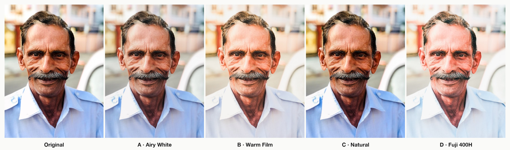
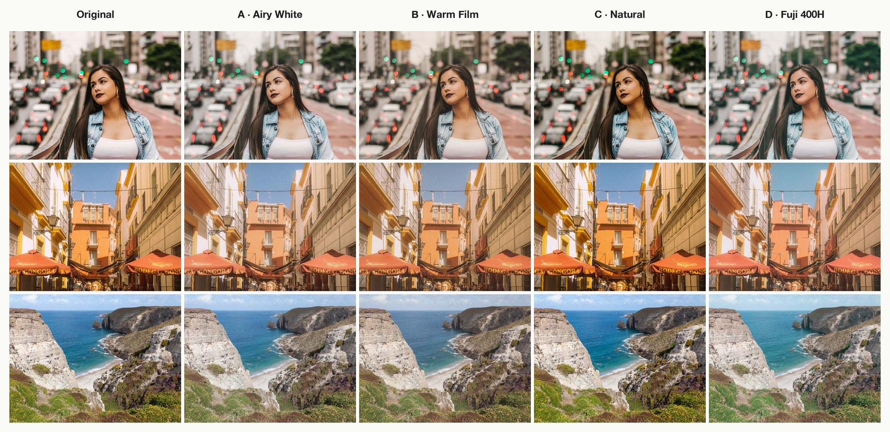
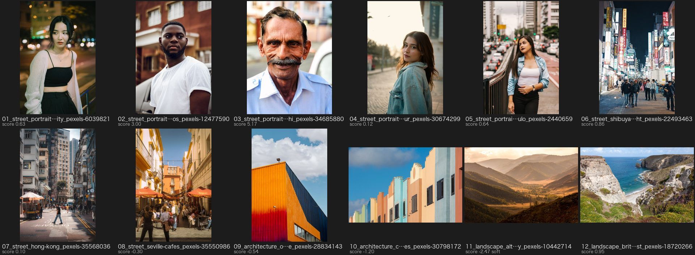

<div align="center">

# Lightroom Agent

**Let your AI agent cull and colour-grade your photos — inside Adobe Lightroom Classic.**

English | [中文](./README_CN.md)

[](./LICENSE)
[](./docs/install-plugin.md)
[](./requirements.txt)
[](./docs/agents.md)
[](./skills/lightroom-agent/SKILL.md)
[](https://github.com/Runnerback/lightroom-agent/stargazers)



<sub>One street portrait, five looks: the original and four styles, each calibrated on the subject's face.</sub>

</div>

---

Tell Claude Code, Codex, Gemini CLI, Cursor, WorkBuddy or Trae *"pick the best shots from my Tokyo trip and give them a
Fuji film look"*, and it does it in **your own Lightroom catalog**: ratings, flags, a picks collection and normal,
editable develop settings. No uploads, no exported copies, nothing locked into another app.

## ✨ What it does

- **Culls like an assistant.** Face sharpness compared with neighbouring frames, closed eyes, exposure, burst and
  near-duplicate grouping. Your agent then looks at the contact sheets and picks the genuine moments with you.
- **Grades with per-photo calibration.** A style is more than a preset: for every photo, exposure is set so the face
  reaches the style's skin tone, and white balance is solved on neutral whites in the frame (or on skin), so a whole
  set looks consistent across changing light. Deep skin tones keep their depth.
- **Respects your work.** Never touches your crop, straighten or orientation, never exports unless you ask, and every
  run can be rolled back.
- **Checks its own quality.** Overview sheets and face-patch QA sheets that the agent reviews before it reports, naming
  the photos that need a look.
- **Styles are plain text.** One Markdown file per look in [`styles/`](./styles/): prose for humans, a JSON block
  for the machine. Your own go in `~/.lightroom-agent/styles/`. Or just ask your agent to create one.

## 🎨 Four built-in styles



| | Style | Look | Good for |
|---|---|---|---|
| **A** | Airy White | high key, soft contrast, clean creamy whites | bright interiors, weddings, high-key portraits |
| **B** | Warm Film | faded blacks, warm split tone, fine grain, light vignette | lifestyle, golden-hour street |
| **C** | Natural | true colour, crisp and clear | street, travel, documentary, landscapes |
| **D** | Fuji 400H | mint greens, cyan shadows, pink skin, pastel haze | daylight portraits, greenery, fresh Japanese look |

<p align="center"></p>

## 🤖 Works with your AI tool

| Tool | How | Setup |
|---|---|---|
| **Claude Code** | plugin (skill + MCP) | `/plugin marketplace add Runnerback/lightroom-agent` |
| **Codex** (CLI / IDE / app) — *for ChatGPT users* | skill + MCP | [docs/agents.md#codex](./docs/agents.md#codex-cli-ide-extension-and-the-codex-app--for-chatgpt-users) |
| **Gemini CLI** | skill + MCP | [docs/agents.md#gemini-cli](./docs/agents.md#gemini-cli) |
| **Cursor** | skill + MCP | [docs/agents.md#cursor](./docs/agents.md#cursor) |
| **WorkBuddy** (CodeBuddy) | skill + MCP | [docs/agents.md#workbuddy](./docs/agents.md#workbuddy-codebuddy) |
| **Trae / Cherry Studio** — *for Doubao models* | skill / MCP | [docs/agents.md#doubao](./docs/agents.md#doubao-models-trae-or-cherry-studio) |
| **Claude Desktop** and any MCP client | MCP | [docs/agents.md#claude-desktop](./docs/agents.md#claude-desktop) |

Use a model with tool calling and image input. The ChatGPT and Doubao chat apps cannot reach programs on your computer;
their models work through Codex and Trae / Cherry Studio.

## 🚀 Quick start

You need Lightroom Classic (macOS or Windows), Python 3.10+ and git.

```bash
git clone https://github.com/Runnerback/lightroom-agent.git
cd lightroom-agent
python3 scripts/install.py
```

The installer sets up a private Python environment, adds the `lightroom-agent` command, installs the Lightroom plugin
and links the skill into the AI tools it finds. **Restart Lightroom Classic**, then check:

```bash
lightroom-agent doctor
```

Plugin details and troubleshooting: [docs/install-plugin.md](./docs/install-plugin.md).
Per-tool setup: [docs/agents.md](./docs/agents.md).

## 💬 Try it

> Cull the folder "2026/0412-Kyoto" in Lightroom. Show me the best 40 and why.

> Put three of them with different light into a proof collection and try styles C and D.

> D it is. Apply it to all the picks and check the skin tones.

> The second one looks too cool — fix it. Then undo everything on the rejected ones.

Behind the scenes the agent runs:

```text
cull ─► contact sheets ─► (agent + you choose) ─► pick: ★★★ + green label + "Kyoto picks" collection
collect proofs ─► apply-style C / D ─► overview sheets ─► apply-style D to all ─► QA ─► report
```

<details>
<summary>Example cull sheet</summary>


</details>

## ⚙️ How it works

```text
AI agent ──(skill: lightroom-agent CLI │ MCP tools)──► Python pipeline ──(localhost socket)──► Lightroom plugin
                                         face detection, Lab measurement,                       develop settings, ratings,
                                         calibration loop, contact sheets                        collections, renders
```

- **Lightroom renders everything.** The pipeline writes develop settings through the plugin, has Lightroom render a
  small JPEG, measures it (YuNet face detection, CIELAB skin and white patches), and adjusts. 3–4 rounds per photo.
- **Plain develop settings.** Results are ordinary Lightroom edits with a history step: tweak them by hand afterwards.
- **Local only.** The plugin listens on `127.0.0.1`; photos never leave your computer (the AI tool sees only the small
  contact sheets it asks for).

## ❓ FAQ

<details>
<summary><b>Does it work with RAW files?</b></summary>

Yes: RAW, DNG, HEIC and JPG. RAW files get calibrated absolute white balance and ISO-based noise reduction; use
`--max-ev 1.5 --iters 4` for RAW shoots. Files you ran through Lightroom's AI Denoise are recognised and left alone.
</details>

<details>
<summary><b>Will it mess up my edits?</b></summary>

It never touches crop, straighten or orientation, and it checks that after every run. Styles overwrite tone and colour
settings; the previous values are saved, and `lightroom-agent rollback --collection NAME` restores them. Lightroom's
History panel works too.
</details>

<details>
<summary><b>What about landscapes and photos without people?</b></summary>

They get the style's look. A faceless photo shot within 30 minutes of a portrait borrows that portrait's calibration
(same light); otherwise it keeps the camera's exposure and white balance.
</details>

<details>
<summary><b>Family photos where the subject is a child?</b></summary>

By default the largest face is the subject. Add `--subject child` and the child next to adults is used instead.
</details>

<details>
<summary><b>Lightroom (cloud) / Capture One / Windows?</b></summary>

Only Lightroom **Classic** has a plugin system. Windows support is implemented but has had less testing than macOS:
reports are welcome.
</details>

<details>
<summary><b>Which Lightroom features can't it automate?</b></summary>

Menu-only features with no SDK access: AI Denoise, HDR / panorama merge, masks. The agent tells you when to use them.
</details>

## 🗂️ Repository

```text
skills/lightroom-agent/SKILL.md   the agent's operating guide (workflow, rules, QA checklist)
styles/                           one .md per style (+ README guide, _template.md)
pipeline/                         cli.py, mcp_server.py, culling, styles, contact sheets
lightroom_plugin/                 LightroomAgent.lrplugin (Lua)
bridge/lr_client.py               socket client for the plugin
scripts/install.py                one-step installer
```

Contributions are welcome, especially new styles (one `.md` file plus a before/after, see
[styles/README.md](./styles/README.md)) and Windows testing.

## 📄 License

[MIT](./LICENSE). Bundled models and dependencies: [THIRD_PARTY_NOTICES.md](./THIRD_PARTY_NOTICES.md). Demo photos
from Pexels, credited in [docs/assets/CREDITS.md](./docs/assets/CREDITS.md).
Not affiliated with Adobe. Adobe, Lightroom and Lightroom Classic are trademarks of Adobe Inc.

## ⭐ Star History

[](https://star-history.com/#Runnerback/lightroom-agent&Date)

<div align="center">

**If Lightroom Agent saves you an evening of culling, please give it a ⭐ — it helps other photographers find it.**

</div>
