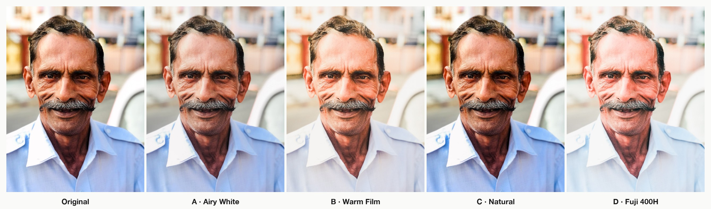
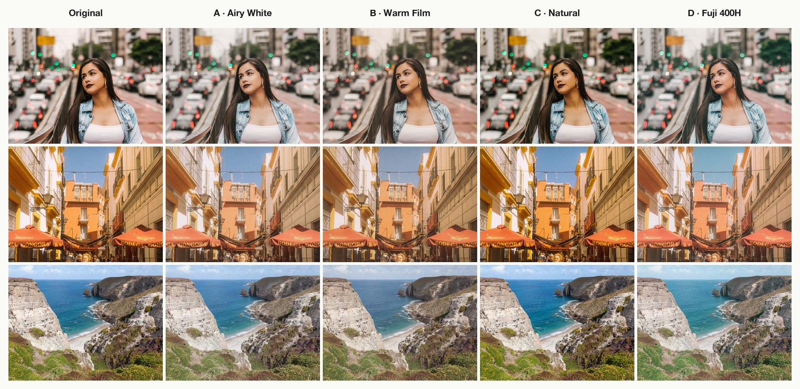
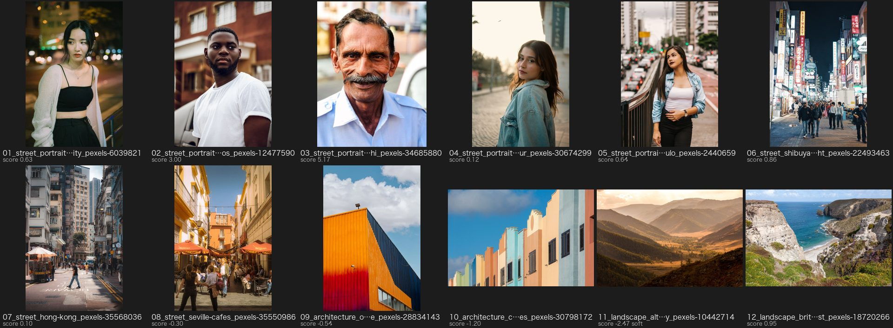

<div align="center">

# Lightroom Agent

**让你的 AI 助手在 Adobe Lightroom Classic 里帮你选片、调色。**

[English](./README.md) | 中文

[](./LICENSE)
[](./docs/install-plugin_CN.md)
[](./requirements.txt)
[](./docs/agents_CN.md)
[](./skills/lightroom-agent/SKILL.md)
[](https://github.com/Runnerback/lightroom-agent/stargazers)



<sub>同一张街拍人像的五种效果:原图和四种风格,每种都按人物肤色逐张校准。</sub>

</div>

---

对 Claude Code、Codex、Gemini CLI、Cursor、WorkBuddy 或 Trae 说一句*"把东京旅行的照片选一遍,挑出好的,调成富士胶片色"*,
它就在**你自己的 Lightroom 目录库**里完成:星级、旗标、精选收藏集,以及普通的、可以继续手动修改的修图参数。
不上传照片,不另存副本,也不把你锁进别的软件。

## ✨ 能做什么

- **像助理一样选片。** 和相邻几张对比人脸清晰度,检测闭眼、曝光,把连拍和近似照片分组只留最好的。然后 AI 看小样图,
  和你一起挑出真正好的瞬间。
- **逐张校准的调色。** 风格不只是预设:每张照片都会调整曝光,让人脸达到风格的肤色亮度;白平衡按画面里的中性白色
  (或肤色)来定。光线变化的一整组照片也能保持一致。深肤色会保留原有的深度,不会被硬提亮。
- **尊重你的修改。** 不动你的裁切、角度和方向;你不说就不导出;每次调色都可以一键撤销。
- **自己检查质量。** 生成总览图和测量位置检查图,AI 先自己看一遍再向你汇报,有问题的照片会点名。
- **风格就是文本文件。** [`styles/`](./styles/) 里每个风格一个 Markdown 文件:文字写给人看,JSON 写给程序。
  你自己的风格放在 `~/.lightroom-agent/styles/`,也可以直接让 AI 帮你新建一个。

## 🎨 四种内置风格



| | 风格 | 效果 | 适合 |
|---|---|---|---|
| **A** | Airy White 清透奶白 | 高调、柔和反差、干净的奶白色 | 明亮室内、婚礼、高调人像 |
| **B** | Warm Film 暖调胶片 | 黑位发灰、暖色分离色调、细颗粒、淡暗角 | 生活记录、黄金时刻街拍 |
| **C** | Natural 自然通透 | 真实色彩、清晰通透 | 街拍、旅行、纪实、风光 |
| **D** | Fuji 400H 富士胶片 | 薄荷绿、阴影偏青、肤色粉嫩、粉彩雾感 | 日光人像、绿植、日系清新 |

<p align="center"></p>

## 🤖 支持的 AI 工具

| 工具 | 方式 | 安装 |
|---|---|---|
| **Claude Code** | 插件(技能 + MCP) | `/plugin marketplace add Runnerback/lightroom-agent` |
| **Codex**(命令行 / IDE / 应用)— *ChatGPT 用户用这个* | 技能 + MCP | [docs/agents_CN.md](./docs/agents_CN.md#codex命令行ide-插件codex-应用chatgpt-用户看这里) |
| **Gemini CLI** | 技能 + MCP | [docs/agents_CN.md](./docs/agents_CN.md#gemini-cli) |
| **Cursor** | 技能 + MCP | [docs/agents_CN.md](./docs/agents_CN.md#cursor) |
| **WorkBuddy**(CodeBuddy) | 技能 + MCP | [docs/agents_CN.md](./docs/agents_CN.md#workbuddycodebuddy) |
| **Trae / Cherry Studio** — *用豆包模型* | 技能 / MCP | [docs/agents_CN.md](./docs/agents_CN.md#豆包模型用-trae-或-cherry-studio) |
| **Claude Desktop** 及任何 MCP 客户端 | MCP | [docs/agents_CN.md](./docs/agents_CN.md#claude-desktop) |

请选择支持工具调用和图片输入的模型。ChatGPT 和豆包的聊天 App 连不到你电脑上的程序,可以分别通过 Codex 和 Trae / Cherry Studio 使用它们的模型。

## 🚀 快速开始

需要:Lightroom Classic(macOS 或 Windows)、Python 3.10+、git。

```bash
git clone https://github.com/Runnerback/lightroom-agent.git
cd lightroom-agent
python3 scripts/install.py
```

安装脚本会建好独立的 Python 环境,添加 `lightroom-agent` 命令,安装 Lightroom 插件,并把技能链接到电脑上找到的 AI 工具。
**重启 Lightroom Classic**,然后检查:

```bash
lightroom-agent doctor
```

插件安装和常见问题:[docs/install-plugin_CN.md](./docs/install-plugin_CN.md)。
各 AI 工具的配置:[docs/agents_CN.md](./docs/agents_CN.md)。

## 💬 试试这样说

> 把 Lightroom 里"2026/0412-京都"这个文件夹选一遍片,挑出最好的 40 张给我看,说说理由。

> 挑 3 张光线不同的放进样片收藏集,试一下 C 和 D 两种风格。

> 就用 D。套到全部精选上,检查一下肤色。

> 第二张有点偏冷,修一下。然后把淘汰的照片都撤销回原样。

AI 在背后执行的流程:

```text
选片 cull ─► 小样图 ─►(AI 和你一起挑)─► pick:★★★ + 绿色标签 + "京都精选"收藏集
建样片集 ─► 套 C / D ─► 总览图 ─► 全部套 D ─► 质量检查 ─► 汇报
```

<details>
<summary>选片小样图示例</summary>


</details>

## ⚙️ 工作原理

```text
AI 助手 ──(技能:lightroom-agent 命令 │ MCP 工具)──► Python 流水线 ──(本机 socket)──► Lightroom 插件
                                         人脸检测、Lab 测量、                    修图参数、星级、
                                         校准迭代、小样图                         收藏集、渲染
```

- **全部由 Lightroom 渲染。** 流水线通过插件写入修图参数,让 Lightroom 渲染一张小 JPEG,测量(YuNet 人脸检测,CIELAB
  肤色和白色区域),再调整。每张 3~4 轮。
- **普通的修图参数。** 结果就是 Lightroom 里普通的修改,带历史记录,之后可以继续手动微调。
- **只在本机运行。** 插件只监听 `127.0.0.1`,照片不会离开你的电脑(AI 工具只看到它请求查看的小样图)。

## ❓ 常见问题

<details>
<summary><b>支持 RAW 吗?</b></summary>

支持 RAW、DNG、HEIC 和 JPG。RAW 会校准绝对色温,并按 ISO 自动降噪;RAW 拍摄建议加 `--max-ev 1.5 --iters 4`。
用 Lightroom AI 降噪处理过的文件会被识别出来,不再额外降噪。
</details>

<details>
<summary><b>会弄乱我已经修好的照片吗?</b></summary>

裁切、角度、方向一律不动,每次运行后都会核对。风格会覆盖影调和色彩参数,但原来的值会保存下来,
`lightroom-agent rollback --collection 收藏集名` 就能恢复,Lightroom 的历史记录面板也可以。
</details>

<details>
<summary><b>风光、建筑这类没有人的照片呢?</b></summary>

会套用风格的效果。如果 30 分钟内拍过人像,就沿用那张的校准(同样的光线);否则保持相机原本的曝光和白平衡。
</details>

<details>
<summary><b>家庭照,主角是小孩?</b></summary>

默认以最大的人脸为主体。加 `--subject child`,就会以大人身边的小孩为主体。
</details>

<details>
<summary><b>Lightroom 云端版 / Capture One / Windows?</b></summary>

只有 Lightroom **Classic** 有插件系统。Windows 已经支持,但测试比 macOS 少,欢迎反馈问题。
</details>

<details>
<summary><b>哪些 Lightroom 功能没法自动化?</b></summary>

没有 SDK 接口、只能在菜单里操作的功能:AI 降噪、HDR / 全景合并、蒙版。需要时 AI 会提醒你去用。
</details>

## 🗂️ 仓库结构

```text
skills/lightroom-agent/SKILL.md   AI 的操作手册(流程、规则、质量检查清单)
styles/                           每个风格一个 .md(另有 README 指南和 _template.md 模板)
pipeline/                         cli.py、mcp_server.py、选片、调色、小样图
lightroom_plugin/                 LightroomAgent.lrplugin(Lua)
bridge/lr_client.py               插件的 socket 客户端
scripts/install.py                一键安装脚本
```

欢迎贡献,尤其是新风格(一个 `.md` 文件加前后对比图,见 [styles/README_CN.md](./styles/README_CN.md))和 Windows 测试。

## 📄 开源协议

[MIT](./LICENSE)。内置模型和依赖见 [THIRD_PARTY_NOTICES.md](./THIRD_PARTY_NOTICES.md)。示例照片来自 Pexels,
作者见 [docs/assets/CREDITS.md](./docs/assets/CREDITS.md)。
本项目与 Adobe 无关。Adobe、Lightroom 和 Lightroom Classic 是 Adobe Inc. 的商标。

## ⭐ Star History

[](https://star-history.com/#Runnerback/lightroom-agent&Date)

<div align="center">

**如果 Lightroom Agent 帮你省下了一个选片的晚上,请点一个 ⭐,让更多摄影爱好者看到它。**

</div>
